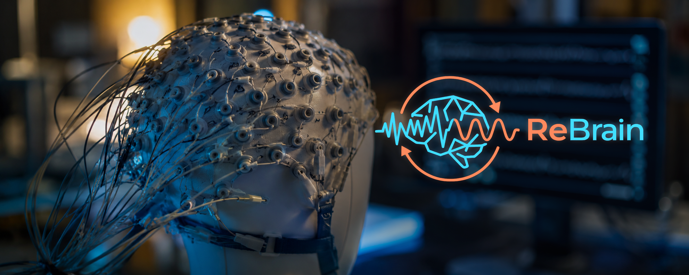

<p align="center">
  
</p>

ReBrain fits a signal-to-signal model on intracranial EEG (iEEG) alone, freezes it,
and inserts it as a plug-and-play front-end that re-expresses scalp EEG through the
iEEG-learned representation before any downstream model: no pairing, no fine-tuning,
no architecture change.

## ⚙️ Installation

```bash
pip install -r requirements.txt
```

Core: PyTorch, Lightning, `vector-quantize-pytorch`, `deepspeed`. The `analysis/`
scripts also use `scipy`, `scikit-learn`, `matplotlib`.

## 🗂️ Data

Config paths are `/path/to/data/...` placeholders; point them at your local copies. All corpora are public.

- **SWEC**: intracranial EEG from the Sleep-Wake-Epilepsy-Center, Bern University Hospital, Switzerland.
- **MC-iEEG**: a multi-center human intracranial EEG epilepsy dataset (OpenNeuro ds003029).
- **CHB-MIT**: pediatric scalp EEG from Children's Hospital Boston, USA.
- **TUSZ**: the Temple University Hospital seizure corpus, USA; the largest public clinical seizure EEG dataset.
- **Siena**: adult focal-epilepsy scalp EEG from the University of Siena, Italy.
- **Beirut**: adult epilepsy scalp EEG from the American University of Beirut Medical Center, Lebanon.

The BIDS loader expects `task-szMonitoring` BIDS recordings with `SamplingFrequency` /
`RecordingDuration` sidecars (e.g. the BIDS version of CHB-MIT). Raw SWEC ships as
`.mat`; convert it first with `scripts/convert_swec_to_bids.py`.

## 🚀 Training

```bash
# 1. SWEC .mat -> BIDS
python scripts/convert_swec_to_bids.py --mode short \
    --input /path/to/data/swec_short_term --output /path/to/data/swec_bids

# 2. fit the iEEG prior
python main.py fit --config configs/ReBrain_train_ieeg_gan.yaml
```


## 🎯 Downstream

`downstream/pipeline.py` is a complete worked example that walks the full pipeline from reprogramming to the downstream task:
it reprograms the scalp EEG through the frozen prior (`rebrain_denoise`), then
trains and evaluates an inline host and writes a metrics JSON. Adapt it
to other hosts by swapping the classifier; for a raw-EEG baseline, drop the
`rebrain_denoise` call.


## 📁 Repository layout

```
main.py                            LightningCLI training entry point (fit)
models/                            ReBrain model (rebrain.py)
datasets/                          BIDS / synthetic-1f / non-human iEEG loaders
utils/                             losses, gradient-norm balancer, conv helpers
configs/                           training configs (main prior + ablations)
scripts/convert_swec_to_bids.py    raw SWEC .mat -> BIDS
downstream/pipeline.py             worked reprogram + example
analysis/                          mechanism-figure analysis (per-feature d', denoiser-vs-amplifier)
```

## 🙏 Acknowledgments

Our implementation builds on EnCodec and BrainCodec (Apache-2.0). We thank the authors for their great work.

## 🏛️ Affiliations

<p align="center">
  
  
  
  
</p>
